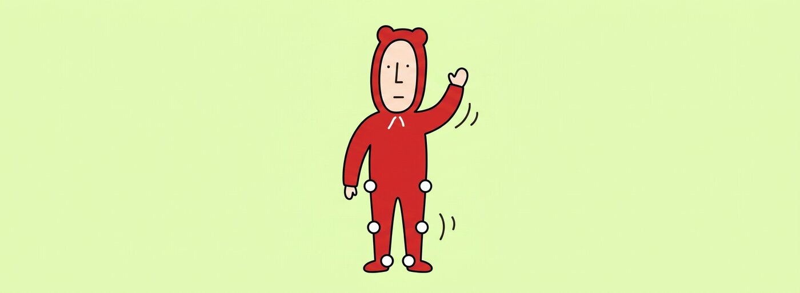
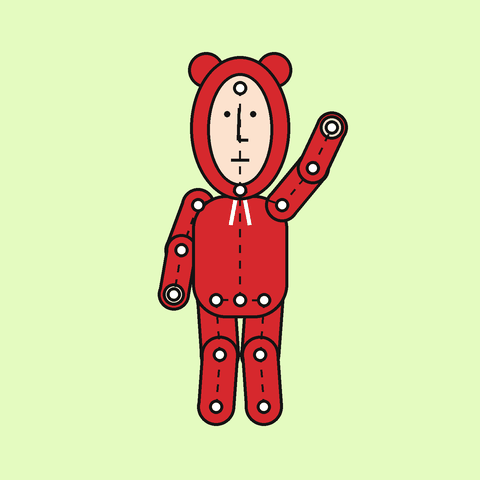
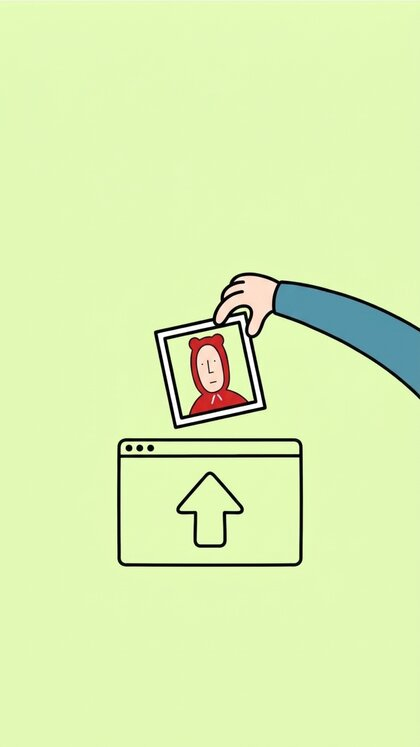
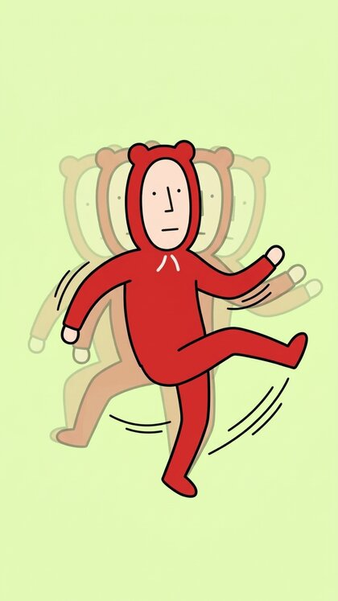

<p align="center">
  
</p>

# Rigpop

Upload a picture, pin joints on it, make it move. Runs entirely in the browser: no build step, no backend, one `index.html`.

<p align="center">
  
  <br><em>Joints (white dots) and bones (dashed) driving a wave and a little bounce.</em>
</p>

<table>
  <tr>
    <td align="center" width="33%"><br><b>1. Upload</b><br>Drop in any 2D drawing.</td>
    <td align="center" width="33%"><br><b>2. Pin joints</b><br>Tap to build the skeleton.</td>
    <td align="center" width="33%"><br><b>3. Make it move</b><br>Presets, JSON or AI keyframes.</td>
  </tr>
</table>

## Run
`npx serve .` (needed for image paths and `?project=`), or just open `index.html` for the demos and uploads. Works on GitHub Pages as is (Settings → Pages → deploy from `main`, root).

## How to use
1. **Upload image**, or tap **🎬 Demos** to start from a ready-made rig: 🥾 Hiker walk, 👋 Stick wave, 🐻 Hoodie dance, 🌷 Tulip sway, 🐙 Octopus wiggle, 🐟 Fish swim, 🦷 Tooth wave and 🤖 Robot dance. The hiker is a marker drawing cut out from its background; the others are drawn in code. All demos live in the `DEMOS` list in `index.html`, so adding one is a single entry (drawing, joints, animation).
2. **Add joints**: tap to place the root first. Tap a joint to select it; the next joint becomes its child. Add a spine or body joint so the torso doesn’t follow the arms.
3. **Move joints** to adjust. **Pose** lets you drag the rotation slider per joint.
4. **Animate**: pick a preset, paste keyframe JSON, or **Generate with AI**.
5. **Record WebM** exports one loop.

## AI provider
Open “AI provider”: any OpenAI-compatible base URL (e.g. `https://api.openai.com/v1`), model, and key. Calls go from the browser straight to `{base}/chat/completions`. The key is kept in localStorage only. If a provider blocks browser calls (CORS), put a tiny proxy in front.

## Animation JSON
```json
{"duration":2.4,"tracks":{"arm":[{"t":0},{"t":0.4,"rot":-150},{"t":2.4}],"hip":[{"t":0},{"t":0.6,"dy":-4},{"t":1.2}]}}
```
`rot` is degrees from the rest pose (positive = clockwise), `dx`/`dy` are pixels and only move root joints. Linear interpolation, always loops.

## How it works
Joints form a tree (forward kinematics). The image is cut into a grid mesh; every vertex follows the nearby bones with distance-based weights (linear blend skinning), and each triangle is drawn with a Canvas 2D affine texture map.

## Roadmap
- Background removal (`@imgly/background-removal`) and tap-to-split parts (SlimSAM via transformers.js)
- AI-suggested joint positions from a vision model
- PixiJS/WebGL renderer, MP4 export (WebCodecs or ffmpeg.wasm)
- Inpainting for the gaps behind moving limbs

## Projects and AI agents
A **project JSON** holds an image reference, the joints and the animation. Open one with **Open project (.json)**, or load it by URL: `http://localhost:3000/?project=projects/name.json`.
To have an AI agent animate your picture, point it at this repo: it starts at `AGENTS.md`, uses `tools/` (`cutout.py`, `grid.py`, `check.py`), follows `docs/ANIMATION_COOKBOOK.md`, and hands back a project file. Copy-paste prompts are in `docs/PROMPTS.md`. A working example is `examples/hiker-walk.project.json`.
